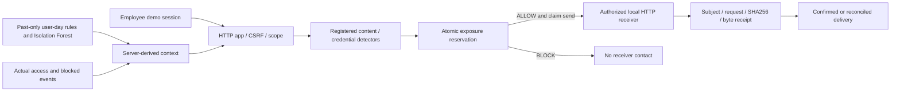

# Technical architecture

One Python 3.12 process hosts the workbench and an independent authorized receiver listener on a random loopback port. They use separate SQLite databases. The live identities and source documents are fictional. The default loopback lab calls no external LLM. The `/portal` route calls either an authenticated fixed-loopback Qwen/llama.cpp CPU model or the explicitly selected OpenAI Responses API after the same gateway admits the original message. The routes never silently fall back between each other. See LOCAL_AI.md and AI_PORTAL.md.

| Component | Responsibility |
| --- | --- |
| `behavior.py` | Completed synthetic days, earlier-day baselines, three rules, actual Isolation Forest, chronological evaluation |
| `ueba.py` | Separate app-only live windows, ordered correlation, supported personal baseline, daily freshness and explained policy context |
| `endpoint.py` | Opt-in scoped Windows observations, distinct-file and exact owned-run sequence checks, source deduplication and sensor health |
| `behavior_cases.py` | Independent persistent observed-evidence findings, bounded typed relationships, review revisions and consistency ledger |
| `policy_explain.py` | Shared budget limits and read-only rule ablation over immutable admission facts |
| `content_security.py` | TR39 skeleton, bounded Base64 views, structured credential/PII validation |
| `mosaic.py` | Registered normalization, exact tuples, anchored distinctive tokens |
| `gateway.py` | Atomic admission, dual windows, idempotency, send claims and transitions |
| `app.py` | Sessions, scoped views, CSRF/Origin checks, observed live rule, fixed destination, receipt validation |
| `ai_portal.py` | Controlled local/OpenAI routes, memory-only external key, bounded calls and durable answer cache |
| `local_ai.py` | Authenticated fixed-loopback Qwen inference; no cloud fallback |
| `receiver.py` | Separate authorized listener and idempotent receipt database |
| `cert_multichannel.py` | Verified four-channel calendar-day development experiment |
| `static/` | Three screens and interactive judge workbench |

Only the server session selects the actor. Clients cannot provide a score or arbitrary provider URL. The app forwards original text unchanged after a durable send claim. The receiver proves the original subject, request ID, digest and byte count. A timeout remains uncertain; reconciliation never sends again.

The lab's completed-day model stays dated; a 72-hour freshness and minimum-history gate controls whether its score contributes to current policy. `ueba.py` separately analyzes observed app reads and durable gateway request metadata in 2-minute/30-minute windows, with a prior-only active-window personal baseline once support is sufficient. Effective policy priority is the maximum eligible component; correlated rules are never summed. Quality saturation has its own explicit guard. Six protected reads remain a small laboratory trigger. Ordered access-to-attempt correlation, bounded source IDs and telemetry gaps are visible. Old requests retain their original context. See [UEBA.md](UEBA.md) for exact rules, windows, concurrency and limits.

CERT v1, CERT v2 and live lab have separate namespaces, fitted models and reports. V2 changes the channels, observation population and primary label target. Its results cannot be presented as a like-for-like improvement over v1. r4.2 was previously inspected, so v2 is development evidence.

Gateway storage keeps hashes/evidence instead of raw prompts. The separate portal cache persists AI output/response metadata for idempotency until reset; output can repeat inputs, so it is potentially sensitive and excluded from packages. API keys stay in server memory. Fingerprints are not anonymous. The proof receiver retains full synthetic payloads until reset; analyst previews are masked. The receiver runs on a separate thread in the same process, not on an external AI provider.

Enterprise deployment requires SSO, provider tenant controls, data-owner approval, retention/access policy, cross-node admission, security review and independent shadow-mode evaluation. Hard content protection never depends on an anomaly alert budget.

In 0.8, collector callbacks and application activity assessment feed a separate transactional case store. A high observed rule with resolvable evidence opens a review case without requiring a policy block. Collector callbacks run outside the endpoint lock, avoiding inversion with the application assessment lock. Case capture is not atomic with the separate gateway ledger; failures surface diagnostically and do not undo delivery. Cases retain bounded evidence snapshots and revision-checked analyst actions after live signals cool. Hash chaining checks internal consistency, not independently trusted provenance. Frozen-policy comparison reproduces the original admission before applying recorded-rule exclusions; it creates no send claim or exposure entry. See [BEHAVIOR_CASES.md](BEHAVIOR_CASES.md).
